# Point clouds

Down-sampling, surface sampling, normal estimation, outlier removal, interpolation and exact
convex hulls.

## Down-sampling: voxel grid, farthest point and blue noise {#pc1}

Three ways to thin the dragon's 437 000 vertices to a few thousand points.
[`voxel_down_sample`][ordito.voxels.voxel_down_sample] averages the points in each occupied
cell of a grid; [`farthest_point_sample`][ordito.points.farthest_point_sample] greedily picks
the point farthest from all picked so far, for an exact count with even coverage; and
[`sample_surface_blue_noise`][ordito.sample.sample_surface_blue_noise] draws new points on
the mesh surface, no two closer than a radius.

```python
import ordito as od
from examples import data

vertices, faces = data.load("dragon", device)

voxel = od.voxels.voxel_down_sample(vertices, 0.004)
farthest = vertices.numpy()[od.points.farthest_point_sample(vertices, voxel.shape[0]).numpy()]
blue, _ = od.sample.sample_surface_blue_noise(vertices, faces, radius=0.0027, seed=1)
print(f"{vertices.shape[0]} input points")
print(f"voxel grid: {voxel.shape[0]}, farthest point: {farthest.shape[0]}")
print(f"blue noise: {blue.shape[0]}")
```

```text title="Output"
437645 input points
voxel grid: 6269, farthest point: 6269
blue noise: 6186
```

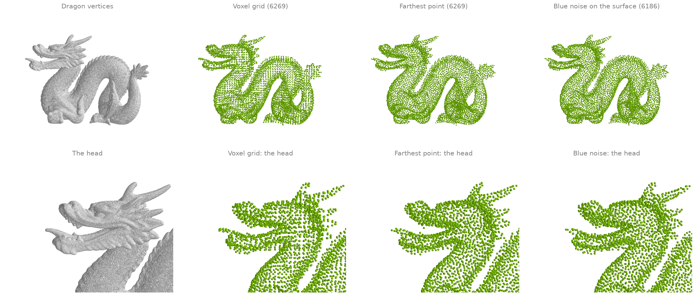

Modelled on: [Open3D: voxel down-sampling](https://www.open3d.org/docs/release/tutorial/geometry/pointcloud.html) · [PyVista: farthest point sampling](https://docs.pyvista.org/examples/01-filter/farthest_point_sampling) · [pytorch3d: sample_farthest_points](https://pytorch3d.readthedocs.io/en/latest/modules/ops.html)
{: .ordito-credits }

## Surface sampling: uniform, Poisson disk and blue noise {#pc2}

[`sample_surface`][ordito.sample.sample_surface] draws points uniformly by area, which leaves
clumps and gaps; [`sample_surface_poisson_disk`][ordito.sample.sample_surface_poisson_disk]
draws five times as many and eliminates the most crowded ones until the requested count
remains, so the same number of points covers the surface more evenly;
[`sample_surface_blue_noise`][ordito.sample.sample_surface_blue_noise] instead takes a
radius and guarantees that no two samples are closer than it. The histogram of each sample's
distance to its nearest neighbour
([`nearest_neighbor_distance`][ordito.neighbors.nearest_neighbor_distance]) shows the
difference: the uniform draw spreads down to zero, the elimination pulls most gaps towards
the typical spacing, and blue noise has a hard floor at its radius.

```python
import numpy as np

import ordito as od
from examples import data

vertices, faces = data.load("bunny", device)
uniform, _ = od.sample.sample_surface(vertices, faces, 4000, seed=1)
poisson, _ = od.sample.sample_surface_poisson_disk(vertices, faces, 4000, seed=1)
blue, _ = od.sample.sample_surface_blue_noise(vertices, faces, radius=0.003, seed=1)

gap_uniform = od.neighbors.nearest_neighbor_distance(uniform).numpy()
gap_poisson = od.neighbors.nearest_neighbor_distance(poisson).numpy()
gap_blue = od.neighbors.nearest_neighbor_distance(blue).numpy()
for name, gap in (("uniform", gap_uniform), ("Poisson", gap_poisson), ("blue", gap_blue)):
    median, smallest = np.median(gap), gap.min()
    print(f"{name:>8}: {len(gap)} samples, gap median {median:.5f}, min {smallest:.5f}")
```

```text title="Output"
 uniform: 4000 samples, gap median 0.00177, min 0.00003
 Poisson: 4000 samples, gap median 0.00315, min 0.00280
    blue: 4016 samples, gap median 0.00316, min 0.00300
```

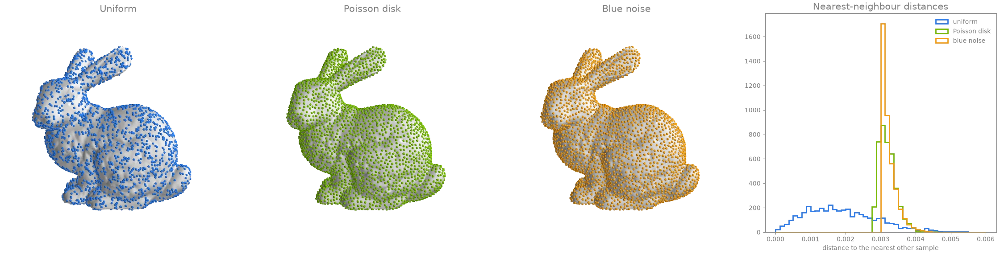

The Poisson-disk histogram keeps a small tail of near-coincident pairs, about 2 % of the
samples closer than a tenth of the typical spacing. Weighted sample elimination should remove
the most crowded points first, so that tail is unexpected; use the blue-noise sampler when a
hard minimum spacing matters.

Modelled on: [Open3D: mesh sampling](https://www.open3d.org/docs/release/tutorial/geometry/mesh.html) · [libigl 810](https://libigl.github.io/tutorial/#blue-noise-sampling) · [PyMeshLab: Poisson-disk sampling](https://pymeshlab.readthedocs.io/en/latest/filter_list.html)
{: .ordito-credits }

## Normal estimation {#pc3}

A bare point cloud has no normals; [`estimate_normals`][ordito.points.estimate_normals] fits
a plane to each point's neighbourhood (here its 16 nearest neighbours from
[`query_nearest`][ordito.neighbors.query_nearest]) and takes the plane's normal. The sign is
a convention, not a measurement: by default each normal is turned away from the cloud's
centroid, which is right on most of the bunny and wrong where the surface folds back towards
the centre (red, compared with the exact normals of the surface the cloud was sampled from).

```python
import numpy as np

import ordito as od
from examples import data

points = data.load_points("bunny_cloud", device)
neighbours, _ = od.neighbors.query_nearest(points, points, k=16)
normals = od.points.estimate_normals(points, neighbours)

# Compare with the exact normals of the surface the cloud was sampled from.
cosine = np.sum(normals.numpy() * data.cloud_normals("bunny_cloud"), axis=1)
angle = np.degrees(np.arccos(np.clip(np.abs(cosine), 0.0, 1.0)))
print(f"median angle to the true normal (ignoring sign): {np.median(angle):.2f} degrees")
print(f"flipped relative to the true normal: {(cosine < 0).mean():.1%} of points")
```

```text title="Output"
median angle to the true normal (ignoring sign): 4.15 degrees
flipped relative to the true normal: 9.9% of points
```

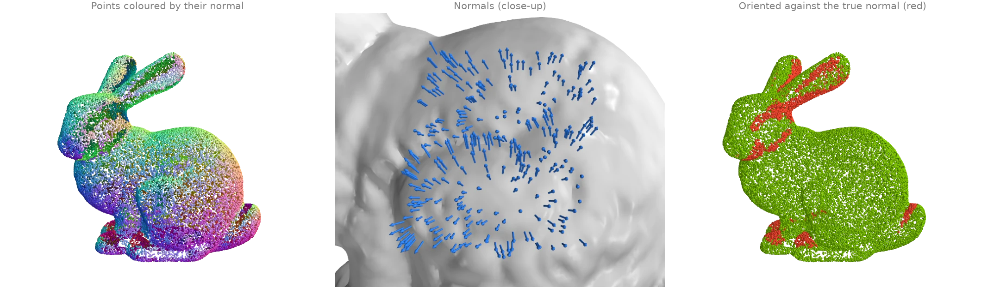

Modelled on: [Open3D: vertex normal estimation](https://www.open3d.org/docs/release/tutorial/geometry/pointcloud.html) · [pytorch3d: estimate_pointcloud_normals](https://pytorch3d.readthedocs.io/en/latest/modules/ops.html)
{: .ordito-credits }

## Outlier removal: statistical, radius and probabilistic {#pc4}

A jittered scan of the bunny with 900 stray points scattered through its bounding box. Three
detectors, all from neighbourhood statistics:

- [`statistical_outlier_mask`][ordito.points.statistical_outlier_mask] flags points whose
  mean distance to their `k` nearest neighbours is far above the cloud's average;
- [`radius_outlier_mask`][ordito.points.radius_outlier_mask] flags points with too few
  neighbours within a fixed radius;
- [`outlier_probability`][ordito.points.outlier_probability] scores each point by how
  stretched its neighbourhood is relative to its neighbours' (Local Outlier Probability).

```python
import numpy as np

import ordito as od
from examples import data

points = data.load_points("noisy_cloud", device)
neighbours, distances = od.neighbors.query_nearest(points, points, k=20)

statistical = od.points.statistical_outlier_mask(distances, std_ratio=2.0).numpy()
radius = od.points.radius_outlier_mask(points, radius=0.004, min_neighbors=4).numpy()
probability = od.points.outlier_probability(neighbours, distances).numpy()

stray = np.arange(points.shape[0]) >= 30_000  # the input's last 900 points are the strays
for name, flagged in (
    ("statistical", statistical),
    ("radius", radius),
    ("LoOP > 0.8", probability > 0.8),
):
    print(f"{name:>11}: flags {flagged.sum()}, of which {(flagged & stray).sum()} strays")
```

```text title="Output"
statistical: flags 657, of which 657 strays
     radius: flags 765, of which 765 strays
 LoOP > 0.8: flags 402, of which 402 strays
```

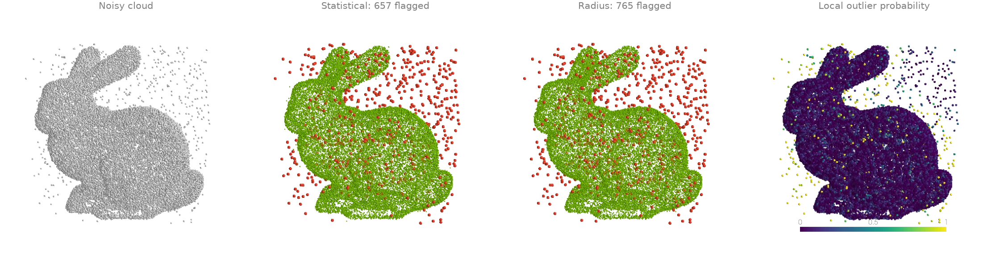

Modelled on: [Open3D: point cloud outlier removal](https://www.open3d.org/docs/release/tutorial/geometry/pointcloud_outlier_removal.html) · [PyMeshLab: select outliers](https://pymeshlab.readthedocs.io/en/latest/filter_list.html)
{: .ordito-credits }

## Cloud-to-cloud distance {#pc5}

Two scans of the same bunny, the second pushed outwards by a bump on its flank and a gentle
ripple. [`query_nearest`][ordito.neighbors.query_nearest] with `k=1` finds, for every point
of the second cloud, its nearest point in the first and the distance to it: a per-point
deviation map with no mesh in sight. For one cloud against itself,
[`nearest_neighbor_distance`][ordito.neighbors.nearest_neighbor_distance] gives each point's
spacing to its closest other point, the noise floor such a comparison sits on.

```python
import numpy as np

import ordito as od
from examples import data

reference = data.load_points("bunny_cloud", device)
displaced = data.load_points("bunny_cloud_displaced", device)

_, distance = od.neighbors.query_nearest(reference, displaced, k=1)
spacing = od.neighbors.nearest_neighbor_distance(reference)
print(f"deviation: median {np.median(distance.numpy()):.5f}, max {distance.numpy().max():.5f}")
print(f"spacing of the reference cloud: median {np.median(spacing.numpy()):.5f}")
```

```text title="Output"
deviation: median 0.00022, max 0.00287
spacing of the reference cloud: median 0.00065
```

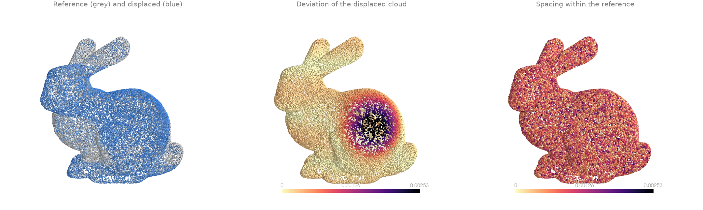

Modelled on: [Open3D: point cloud distance](https://www.open3d.org/docs/release/tutorial/geometry/pointcloud.html) · [PyVista: distance between point clouds](https://docs.pyvista.org/examples/01-filter/distance_between_surfaces)
{: .ordito-credits }

## Interpolating sparse samples onto a surface {#pc6}

A field measured at only 60 probe points, spread over the bunny by
[`farthest_point_sample`][ordito.points.farthest_point_sample], is carried onto every vertex
by [`interpolate_from_points`][ordito.interpolation.interpolate_from_points]: a
Gaussian-weighted mean of the nearby probes. With a radius footprint, vertices farther than
the radius from every probe get the `null_value` (grey); with `k` nearest probes every vertex
gets a value, however far its probes are.

```python
import numpy as np
import warp as wp

import ordito as od
from examples import data

vertices, _ = data.load("bunny", device)
probes = vertices.numpy()[od.points.farthest_point_sample(vertices, 60).numpy()]
readings = np.sin(40.0 * probes[:, 0]) + np.cos(40.0 * probes[:, 1])  # the "measurement"

source = wp.array(probes, dtype=wp.vec3, device=device)
values = wp.array(readings, dtype=wp.float32, device=device)
by_radius = od.interpolation.interpolate_from_points(
    source, values, vertices, radius=0.015, null_value=float("nan")
)
by_neighbours = od.interpolation.interpolate_from_points(
    source, values, vertices, radius=0.015, k=4
)
print(f"vertices with no probe within the radius: {np.isnan(by_radius.numpy()).sum()}")
```

```text title="Output"
vertices with no probe within the radius: 9266
```

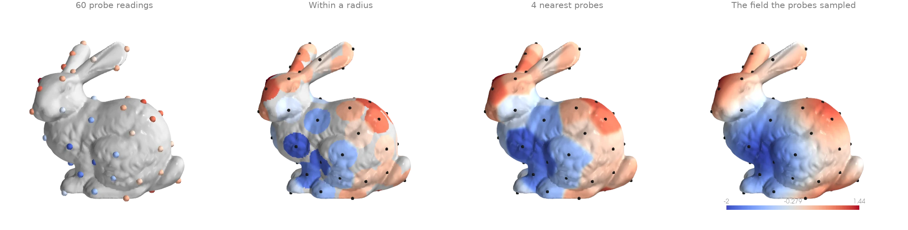

Modelled on: [PyVista: interpolate](https://docs.pyvista.org/examples/01-filter/interpolate)
{: .ordito-credits }

## Convex-hull points and half-space tests {#pc7}

Which points of the cloud lie on its convex hull?
[`convex_subset_mask`][ordito.points.convex_subset_mask] marks the points that are extreme
along some sampled direction: every one is on the hull, and more directions find more of
them. [`convex_superset_mask`][ordito.points.convex_superset_mask] answers the other way
round, discarding only points provably inside, so every hull vertex survives.
[`half_space_mask`][ordito.points.half_space_mask] is the building block: the points strictly
on one side of a plane. Both masks approximate the vertex set without building a surface; the
hull's triangles, exactly, come from [`convex_hull`][ordito.points.convex_hull]
([next example](#pc8)).

```python
import warp as wp

import ordito as od
from examples import data

points = data.load_points("bunny_cloud", device)
on_hull = od.points.convex_subset_mask(points, n_directions=4096).numpy()
candidates = od.points.convex_superset_mask(points).numpy()
upper = od.points.half_space_mask(
    points, wp.vec3(0.3, 1.0, 0.0), plane_origin=wp.vec3(0.0, 0.11, 0.0)
).numpy()
print(f"{on_hull.sum()} points certified on the hull (subset)")
print(f"{candidates.sum()} points that may be on it (superset), of {points.shape[0]}")
print(f"{upper.sum()} points above the plane")
```

```text title="Output"
1104 points certified on the hull (subset)
6340 points that may be on it (superset), of 30000
9513 points above the plane
```

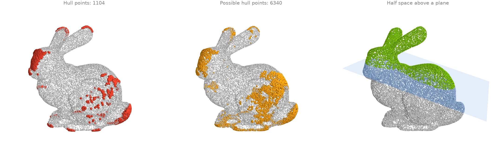

Checked against an exact hull (`scipy.spatial.ConvexHull`, 1564 vertices on this cloud): all
1104 points of the subset are hull vertices, and every hull vertex is among the superset's
candidates.

Modelled on: [Open3D: convex hull](https://www.open3d.org/docs/release/tutorial/geometry/pointcloud.html) · [trimesh: convex](https://trimesh.org/trimesh.convex.html)
{: .ordito-credits }

## Exact convex hull {#pc8}

[`convex_hull`][ordito.points.convex_hull] returns the convex hull of a cloud as triangles
that index the input points, the layout of [`scipy.spatial.ConvexHull`][]'s `simplices`. Each
triangle is wound counter-clockwise seen from outside, and a hull of `V` vertices has `2V - 4`
of them. Every decision the algorithm takes is an exact orientation sign, with the same answer
on the CPU and the CUDA device and no tolerance to tune, so the hull is the true hull of the
`float32` points: its vertex set equals qhull's on both clouds below, the bunny sampled at
30 000 points and the dragon scan's 437 645 vertices.
[`remove_unreferenced_vertices`][ordito.repair.remove_unreferenced_vertices] turns the
triangles into a compact mesh, outward-facing and ready for a [`Trimesh`][ordito.mesh.Trimesh].

```python
import numpy as np
import scipy.spatial

import ordito as od
from examples import data

clouds = {"bunny cloud": data.load_points("bunny_cloud", device)}
clouds["dragon scan"], _ = data.load("dragon", device)
hulls = {}
for name, points in clouds.items():
    faces = od.points.convex_hull(points)
    hull_vertices = np.unique(faces.numpy())
    qhull = scipy.spatial.ConvexHull(points.numpy())
    print(
        f"{name}: {points.shape[0]} points, hull of {hull_vertices.size} vertices "
        f"and {faces.shape[0] // 3} triangles, same vertices as qhull: "
        f"{np.array_equal(hull_vertices, np.sort(qhull.vertices))}"
    )
    hulls[name] = od.repair.remove_unreferenced_vertices(points, faces)[:2]
```

```text title="Output"
bunny cloud: 30000 points, hull of 1564 vertices and 3124 triangles, same vertices as qhull: True
dragon scan: 437645 points, hull of 2536 vertices and 5068 triangles, same vertices as qhull: True
```

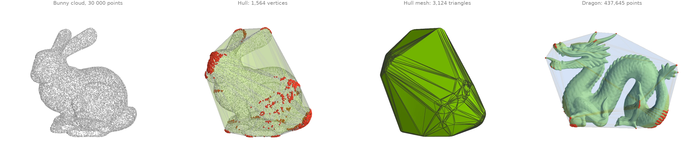

**How it works.** The algorithm is ffHull (Gao, Cao, Tan and Huang, *Flip-Flop: Convex Hull
Construction via Star-Shaped Polyhedron in 3D*, I3D 2013). Incremental algorithms such as
quickhull add one point at a time. ffHull keeps the surface *star-shaped* instead of convex,
every face seeing one fixed kernel point inside, and that weaker invariant can be kept by
thousands of local edits at once. The surface starts as a tetrahedron. Each round, every face
with points beyond it splits into three at the farthest of them, all at once, and the points
the new surface encloses leave the computation for good, so the cost follows the points near
the hull rather than the size of the cloud. The figure runs the same growth in the plane (the
cross is the kernel point; blue points are still outside, grey ones dropped):

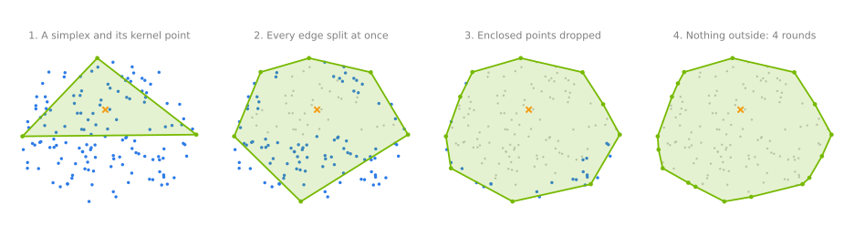

In the plane the growth ends convex. In space it ends with *reflex* edges, dents where two faces
meet inward. Flip-Flop removes them with edge flips, again in parallel: a 2-2 flip swaps the
shared diagonal of two triangles (red) for the other one (blue) and only grows the volume;
where a dent cannot be flipped away, one of its vertices is provably not extreme and a 3-1 flip
deletes it. ordito also flips during growth, which drops the points under the dents early (2.4x
fewer flip rounds on the dragon, 3x on the bunny).

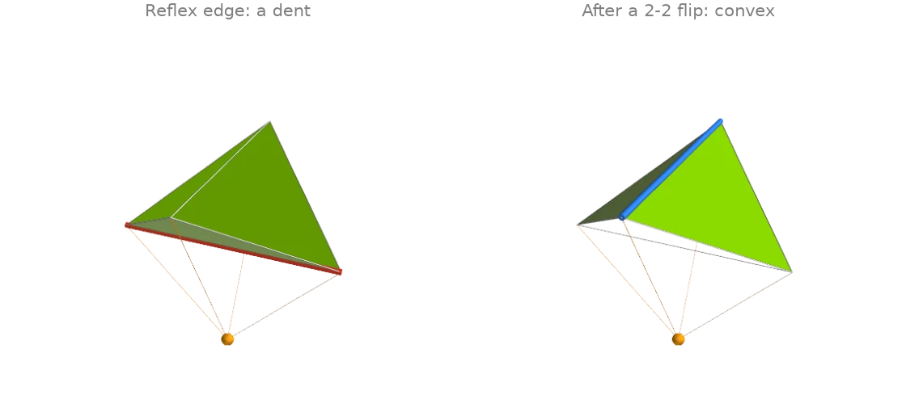

**Speed.** qhull, behind SciPy, trimesh, Open3D and MeshLab, is single-threaded on the host.
On the dragon's 437 645 points:


The gap is about 5x on the bunny's 35 947 points and 22x on the dragon. A GPU call has a floor
of a couple of milliseconds, so below a few thousand points qhull is as fast or faster.

Modelled on: [Open3D: convex hull](https://www.open3d.org/docs/release/tutorial/geometry/pointcloud.html) · [trimesh: convex](https://trimesh.org/trimesh.convex.html)
{: .ordito-credits }

## Convex hulls of degenerate clouds {#pc9}

The clouds a tolerance-based hull gets wrong are the ones made of exact coincidences. A
9 x 9 x 9 lattice has every point of a face in one plane and every point of an edge on one
line: [`convex_hull`][ordito.points.convex_hull] keeps the 8 corners and nothing else. An
octahedron's 6 corners, with 2 000 more points placed *exactly* on its faces (multiples of
1/64, which `float32` stores without rounding), keep the corners alone. A disc 2e-6 thick, six
orders of magnitude thinner than it is wide, is still a solid: its hull runs round the rim and
over the few interior points that stand proud of their neighbours by a fraction of a micron.
Each hull's vertex set is checked against `scipy.spatial.ConvexHull`.

```python
import numpy as np
import scipy.spatial
import warp as wp

import ordito as od

rng = np.random.default_rng(0)
axis = np.linspace(-1.0, 1.0, 9)
lattice = np.stack(np.meshgrid(axis, axis, axis, indexing="ij"), axis=-1).reshape(-1, 3)

# Points on the octahedron |x| + |y| + |z| = 1 with coordinates in multiples of 1/64.
steps = rng.integers(0, 65, size=(4000, 2))
steps = steps[steps.sum(axis=1) <= 64][:2000]
signs = rng.choice([-1.0, 1.0], size=(steps.shape[0], 3))
on_faces = signs * np.column_stack([steps, 64 - steps.sum(axis=1)]) / 64.0
octahedron = np.vstack([np.eye(3), -np.eye(3), on_faces])

disc = rng.uniform(-1.0, 1.0, size=(6000, 2))
disc = disc[np.hypot(disc[:, 0], disc[:, 1]) < 1.0]
slab = np.column_stack([disc, rng.uniform(-1e-6, 1e-6, size=disc.shape[0])])

clouds = {"lattice": lattice, "octahedron": octahedron, "slab": slab}
hulls = {}
for name, cloud in clouds.items():
    points = wp.array(cloud, dtype=wp.vec3, device=device)
    faces = od.points.convex_hull(points)
    hull_vertices = np.unique(faces.numpy())
    qhull = scipy.spatial.ConvexHull(points.numpy())
    print(
        f"{name}: {points.shape[0]} points, {hull_vertices.size} hull vertices, "
        f"same as qhull: {np.array_equal(hull_vertices, np.sort(qhull.vertices))}"
    )
    hulls[name] = (points.numpy(), faces.numpy().reshape(-1, 3))
```

```text title="Output"
lattice: 729 points, 8 hull vertices, same as qhull: True
octahedron: 2006 points, 6 hull vertices, same as qhull: True
slab: 4750 points, 179 hull vertices, same as qhull: True
```

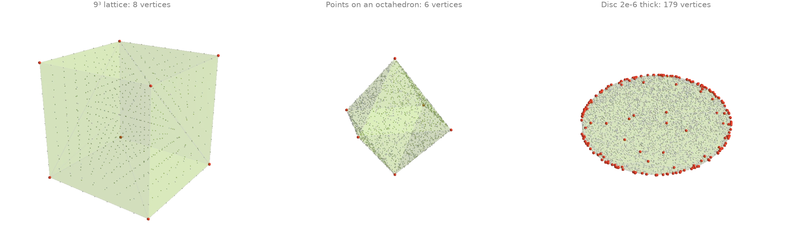

The rules for degenerate input:

- **Coplanar points on a facet** (the lattice's faces): the facet is triangulated arbitrarily,
  and the points inside it are not vertices.
- **Collinear points along a hull edge**: only the two ends are vertices.
- **Coincident points**: one of them is kept as the vertex.
- **A cloud a fraction of a micron thick**: still a solid, hulled like any other.
- **Fewer than 4 points, or no 4 spanning a tetrahedron** (an exactly flat cloud): `ValueError`,
  as there is no volume to bound.

Modelled on: [trimesh: convex](https://trimesh.org/trimesh.convex.html)
{: .ordito-credits }
