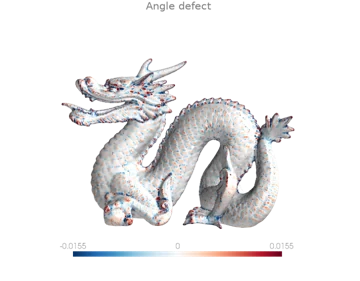
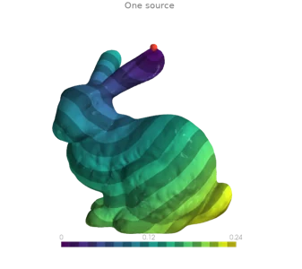
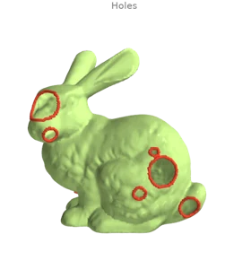
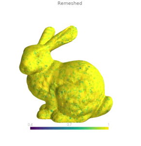
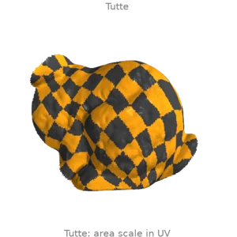
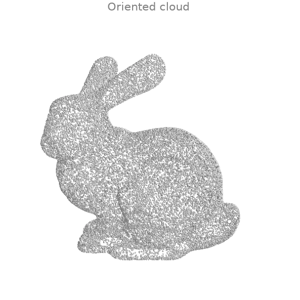

<h1 class="ordito-wordmark">
  
  
</h1>

**ordito** is a GPU mesh processing library for Python, built on
[NVIDIA Warp](https://github.com/NVIDIA/warp): triangle meshes and point clouds processed with
CUDA kernels. It provides mesh geometry, connectivity, queries,
editing, and solvers as plain array-in / array-out functions backed by Warp kernels, with a
[trimesh](https://trimesh.org)-inspired API. Every function runs on CUDA when a GPU is available
and falls back to CPU otherwise, with the same code.

*Ordito* (or-DEE-toh) is Italian for the **warp** of a fabric, and an anagram of
**toroid**: a fitting name for a mesh library built on Warp.

<div class="grid cards ordito-gallery ordito-hero" markdown>

-   [](examples/differential.md#d1)

    [Curvature](examples/differential.md#d1)

-   [](examples/geodesics.md#g1)

    [Geodesic distance](examples/geodesics.md#g1)

-   [](examples/repair.md#h1)

    [Hole filling](examples/repair.md#h1)

-   [](examples/remesh.md#r4)

    [Isotropic remeshing](examples/remesh.md#r4)

-   [](examples/parametrization.md#p1)

    [Parametrization](examples/parametrization.md#p1)

-   [](examples/reconstruction.md#rr1)

    [Surface reconstruction](examples/reconstruction.md#rr1)

</div>

## Highlights

- **One dependency.** The runtime depends on `warp-lang` alone; NumPy comes with Warp; nothing else
  (no SciPy, PyTorch or trimesh) is needed at runtime.
- **Broad coverage.** Hundreds of functions across dozens of public modules, spanning primitives, topology,
  repair, remeshing, spatial queries, discrete differential operators, geodesics, sampling,
  surface reconstruction, and registration.
- **Stays on the device.** Functions take Warp arrays and return Warp arrays, so pipelines compose
  without host round-trips; device placement follows the inputs.
- **Optional `Trimesh` object.** A frozen mesh class with lazily cached derived quantities
  (normals, adjacency, boundary loops, manifoldness and watertightness predicates, BVH) for when
  an object API is more convenient than free functions.
- **Exact where it matters.** [Convex hulls](examples/points.md#pc8) and other topological
  decisions take exact orientation signs, so the answer does not depend on a tolerance or on the
  device.
- **Reproducible on demand.** One switch, `od.set_deterministic(True)`, makes results repeat bit
  for bit on CUDA; see [Reproducible results](reproducibility.md).
- **Fully typed** (`py.typed`) and validated function-by-function against eleven reference
  implementations — nine established geometry-processing libraries plus SciPy and NumPy, all
  listed below.

## Install

=== "pip"

    ```bash
    pip install ordito
    ```

=== "uv"

    ```bash
    uv add ordito
    ```

Requires Python ≥ 3.11 and `warp-lang` ≥ 1.18. A CUDA-capable GPU is recommended but not required.
Mesh file I/O via [meshio](https://github.com/nschloe/meshio) is an optional extra:
`pip install "ordito[io]"`.

## Quickstart

```python
import ordito as od

# Parametric primitives allocate directly on the default device (CUDA if available).
vertices, faces = od.creation.icosphere(subdivisions=4)

# Optional object API: derived quantities are computed on first access and cached.
mesh = od.Trimesh(vertices, faces)
print(f"{mesh.area:.4f}")  # 12.5514
print(mesh.is_watertight)  # True
print(mesh.euler_characteristic)  # 2

# Feature-preserving isotropic remeshing (split / collapse / flip / smooth / reproject).
remeshed_vertices, remeshed_faces = od.remesh.isotropic_remesh(vertices, faces, target_length=0.05)
```

Continue with **[Getting started](getting-started.md)** for the full walkthrough (including a
repair-then-remesh pipeline on a realistically broken mesh), or jump straight to a task:

- **[Concepts](concepts.md)** — the design principles worth knowing before writing anything
  nontrivial.
- **[Examples](examples/index.md)** — a gallery of runnable examples, each with the image it
  produces: creation, inspection, curvature, geodesics, parametrization, smoothing, remeshing,
  repair, voxels, queries, cutting, point clouds, reconstruction and registration.
- **[Migrating from another library](migrating-from/index.md)** — already know trimesh, libigl,
  Open3D, MeshLab, potpourri3d, or PyTorch3D? Start here.
- **[Benchmarks](benchmarks/index.md)** — a curated set of ordito-vs-reference comparisons, rendered as
  charts, each library named by its own logo.

## One GPU library instead of nine

Mesh processing in Python has long meant stitching together several excellent — but mostly
CPU-bound and stylistically different — libraries. ordito consolidates the functionality it needs
from each of them behind a single GPU-accelerated API:

| Replaces | For | In ordito |
|---|---|---|
| [trimesh](https://github.com/mikedh/trimesh) | Mesh bookkeeping: edges, adjacency, boundary, validation, primitives, sampling, proximity | `edges`, `adjacency`, `boundary`, `validation`, `creation`, `sample`, `proximity`, the `Trimesh` class |
| [libigl](https://libigl.github.io/) ([Python bindings](https://github.com/libigl/libigl-python-bindings)) | Discrete differential geometry: cotangent Laplacians, mass matrices, curvature, parametrization, heat-method geodesics | `laplacian`, `energies`, `curvature`, `parametrization`, `heat` |
| [Open3D](https://www.open3d.org/) | Point clouds, registration, and surface reconstruction: ICP, screened Poisson, ball pivoting | `points`, `registration`, `reconstruction` |
| [MeshLab](https://www.meshlab.net/) ([PyMeshLab](https://github.com/cnr-isti-vislab/PyMeshLab)) | Mesh editing filters: isotropic remeshing, decimation, smoothing, hole filling, uniform resampling | `remesh`, `smoothing`, `holes`, `repair` |
| [PyVista](https://pyvista.org/) (VTK) | The VTK toolkit: feature edges, cell-quality metrics, contouring and clipping, point location, arc-length and polyline measures, voxelization | `edges`, `triangles`, `intersection`, `levelset`, `proximity`, `polyline`, `voxels` |
| [MeshLib](https://meshlib.io/) | Minimum-weight hole filling and stitching, self-intersection repair, voxel offsets and booleans, projection queries, spike and outlier detection | `holes`, `repair`, `levelset`, `voxels`, `proximity`, `points` |
| [PyMeshFix](https://github.com/pyvista/pymeshfix) (MeshFix / TMesh) | The repair pipeline end to end: a broken digitised surface in, one watertight solid out | `repair`, `holes`, `validation` |
| [potpourri3d](https://github.com/nmwsharp/potpourri3d) (geometry-central) | The heat-method family: vector heat, parallel transport, log maps, signed distance, tangent frames | `heat`, `tangent_space` |
| [PyTorch3D](https://pytorch3d.org/) | Batched neighbour and Chamfer primitives, the mesh regularization losses, cubify and marching cubes | `metrics`, `neighbors`, `energies`, `registration`, `levelset`, `voxels` |

[SciPy](https://scipy.org/)'s `spatial.KDTree` and `sparse.csgraph` (covered by `neighbors`,
`graph` and `proximity`) and NumPy's array primitives (`array`, `reduce`, `grouping`, `linalg`)
round the set out to the eleven reference implementations the suite measures against.

These libraries are not runtime dependencies; they are **test oracles**. Wherever one of them
computes the same quantity as an ordito function, a regression test compares the two outputs
value by value. A parity gate in the test suite fails the build if any library the benchmarks
time against ordito is neither compared in a test nor exempted with a written reason. Every
`(group, library)` pair in the benchmark suite is either covered by a value test or carries a
written exemption (typically a different algorithm answering a related question); none are
uncovered, and `python -m tests.parity` prints the current matrix. Where ordito and a reference disagree by definition rather than by rounding
(a sign convention, a squared distance), the docstring says so and the test pins the difference.

## Development

```bash
git clone https://github.com/lucagrementieri/ordito
cd ordito
uv sync --all-groups            # runtime + dev + test + docs + bench dependencies

uv run pytest                   # regression tests against the reference libraries
uv run ruff format ordito tests && uv run ruff check ordito tests
uv run basedpyright             # type checking (0 errors expected)

uv run zensical serve           # preview the docs locally
```

See the [source repository](https://github.com/lucagrementieri/ordito) for contribution
guidelines and the full development setup.
