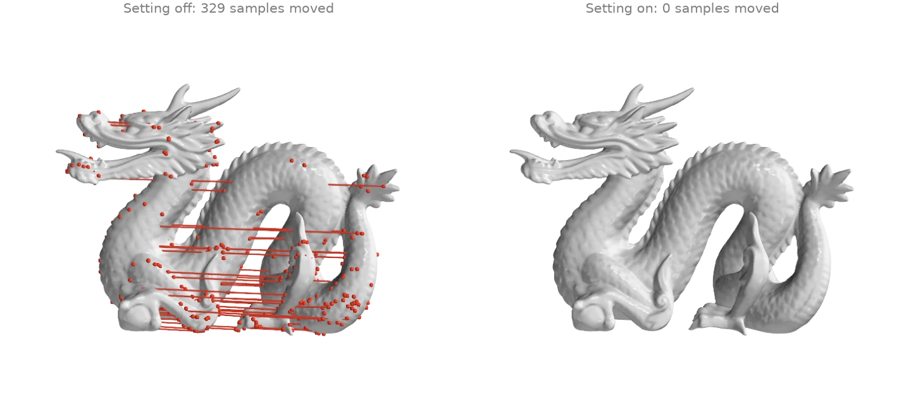
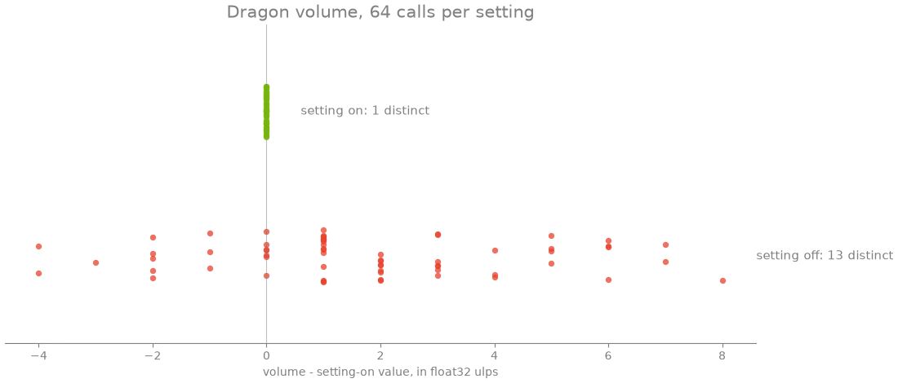

# Reproducible results

Call an ordito function twice on the same input on a GPU, and the two results can differ in their
last bits. Thousands of GPU threads add partial sums as they finish, and floating-point addition
depends on order: `(a + b) + c` is not always `a + (b + c)`. Most of the time the difference is a
unit in the last place and nobody notices. Sometimes it is not: a seeded sampler draws a different
point, a threshold flips, a regression test that compares bytes fails at random.

ordito has one switch for this. With **determinism on**, every result the setting governs repeats
bit for bit from call to call on CUDA. With it off, the default, those results come from the
faster arrival-order forms.

```python
import numpy as np

import ordito as od

vertices, faces = od.creation.icosphere(subdivisions=4)
with od.deterministic(True):
    first, _ = od.sample.sample_surface(vertices, faces, 10_000, seed=0)
    second, _ = od.sample.sample_surface(vertices, faces, 10_000, seed=0)
print(np.array_equal(first.numpy(), second.numpy()))  # True
```

## What it looks like

The dragon scan, sampled twice with the same seed on an RTX 5090. With the setting off, a few
hundred of the 100 000 samples land somewhere else on the second call, often far from where they
were; with it on, none do.



The sampler picks each sample's face by searching a running sum of the face areas. On CUDA that
running sum is a parallel scan whose blocks combine in the order they finish, so a few of its
entries round differently from one call to the next, and a sample drawn right at one of those
entries picks the adjacent face *in index order*, which on a scan can be on the other side of the
model. The same happens to a plain sum: 64 calls of [`volume`][ordito.measures.volume] on the
dragon returned 13 different values with the setting off, up to a dozen `float32` units in the
last place apart, and one with it on.



Both figures come from the [Reproducible results examples](examples/reproducibility.md), which
have the code.

## Turning it on

Three entry points, all in [`ordito.config`][ordito.config] and also reachable from the package
itself:

| Call | Scope |
|---|---|
| [`od.set_deterministic(True)`][ordito.config.set_deterministic] | Process-wide default, seen by every thread and task |
| [`with od.deterministic(True):`][ordito.config.deterministic] | The current thread or `asyncio` task, until the block exits |
| [`od.is_deterministic()`][ordito.config.is_deterministic] | Reads the setting in force here |

```python
od.set_deterministic(True)
print(od.is_deterministic())  # True

with od.deterministic(False):
    print(od.is_deterministic())  # False
print(od.is_deterministic())  # True

od.set_deterministic(False)
```

The context manager nests, restores the previous value on exit even when the block raises, and
wins over the process default for as long as it is active. A task created inside the block
inherits the override; a new thread starts from the process default. There is no per-function
`deterministic=` keyword: the setting is read when a reduction launches, so it reaches every
reduction a call makes, including the ones inside solvers and loops.

### In a test suite

The common pattern is determinism on for every test, so that a comparison of bytes means
something, and off for benchmarks, so that they time what users run. ordito's own suite does
exactly this, in its `conftest.py`:

```python
import pytest


@pytest.fixture(autouse=True)
def _deterministic_by_default() -> None:
    od.set_deterministic(True)
```

## What it governs

On the **CUDA** device:

- **Floating-point reductions and `float32` scans**: sums, means, moments and fits, the reductions
  inside the energies, metrics, measures and registration, the solver loops, and the cumulative
  sums behind every sampler, arc length and resampling.
- **Per-group sums** of [`scatter_sum`][ordito.reduce.scatter_sum] and
  [`segment_sum`][ordito.reduce.segment_sum], which are then summed *exactly* in fixed point and
  rounded once. Their result is identical on the CPU and the CUDA device too.
- **Per-vertex and per-component sums** inside geometry functions: lumped masses, Hessian
  energies, vertex defects, the local steps of [`arap`][ordito.parametrization.arap], loop
  perimeters and areas, the component volumes and areas
  [`repair`](api/ordito/repair.md) decides on, the positions of
  [`subdivide_loop`][ordito.remesh.subdivide_loop],
  [`cluster_decimate`][ordito.remesh.cluster_decimate] and
  [`isotropic_remesh`][ordito.remesh.isotropic_remesh], and the lattice of
  [`screened_poisson`][ordito.reconstruction.screened_poisson].
- **The order of some outputs** that are filled through atomic slots: the rows of
  [`vertex_face_adjacency`][ordito.adjacency.vertex_face_adjacency] (ascending), the hits of
  [`intersects_location`][ordito.ray.intersects_location] (by ray) and the faces of the polyline
  triangulations.
- **Gradients** taken with a `wp.Tape` through the differentiable Chamfer losses.

The complete list, function by function, is in the [`ordito.config`][ordito.config] reference.

What it does **not** govern:

- **The CPU device**, which runs its blocks one after another and is deterministic either way.
  Turning the setting on there leaves almost every result unchanged; the reference names the few
  exact sums whose last bits differ from the plain sum they replace.
- **Integer reductions and scans**, which are exact in any order.
- **Agreement between devices** in general. CPU and CUDA results can still differ in the last bits,
  because the GPU compiler fuses multiplies and adds that the CPU compiler keeps apart. The setting
  makes each device repeat itself; the exact group sums above are the exception that also agree
  across devices.
- **A few other atomic scatters**, such as vertex areas and normals, which stay in arrival order,
  and repeat anyway because they are summed exactly.

## What it costs

The fixed-order forms do more work: a reduction stores one partial per block and adds them in a
fixed order, a scan takes a fixed-order tile scan, and an output in a fixed order takes a stable
sort. For most calls this is a few microseconds; for a call whose whole job is one of those sorts,
it is more. Measured on an RTX 5090, median of 30 interleaved calls, CUDA:

| Call | Off | On | On / off |
|---|---|---|---|
| [`measures.volume`][ordito.measures.volume], dragon (871 k faces) | 0.044 ms | 0.044 ms | 1.00x |
| [`sample.sample_surface`][ordito.sample.sample_surface], dragon, 1 M samples | 0.27 ms | 0.28 ms | 1.05x |
| [`remesh.isotropic_remesh`][ordito.remesh.isotropic_remesh], bunny, 3 iterations | 12.5 ms | 12.6 ms | 1.01x |
| [`reduce.scatter_sum`][ordito.reduce.scatter_sum], 10 M values into 1 000 groups | 0.68 ms | 0.53 ms | 0.78x |
| [`adjacency.vertex_face_adjacency`][ordito.adjacency.vertex_face_adjacency], dragon | 0.16 ms | 0.39 ms | 2.45x |

The exact group sum can even be the faster one: it avoids the contention of many threads adding
into one address. The adjacency rows pay for a stable sort that puts each row in ascending order.
In a pipeline, the setting usually costs a few percent.

## Caveats

- **CUDA graphs keep the mode they were recorded with.** A graph captured with the setting off
  replays the arrival-order kernels after you turn it on. Re-capture after a change.
- **Cached state keeps the mode it was built in.** A [`Trimesh`][ordito.mesh.Trimesh]'s heat
  operators and solvers are built once and reused; build them, or the mesh, after setting the mode.
  [`Trimesh.vertex_face_adjacency`][ordito.mesh.Trimesh.vertex_face_adjacency] is the exception:
  a value cached with the setting off is rebuilt in ascending order the first time it is read with
  the setting on.
- **Reproducible is not the same as correct.** A result that repeats is not more accurate than one
  that does not; both are within the rounding error of the algorithm. Turn the setting on for
  reproducibility (tests, debugging, seeded pipelines, comparing runs), not for precision.
